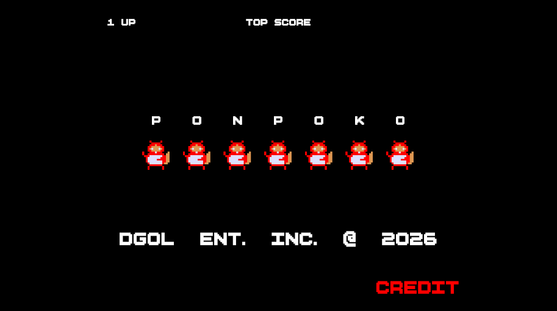
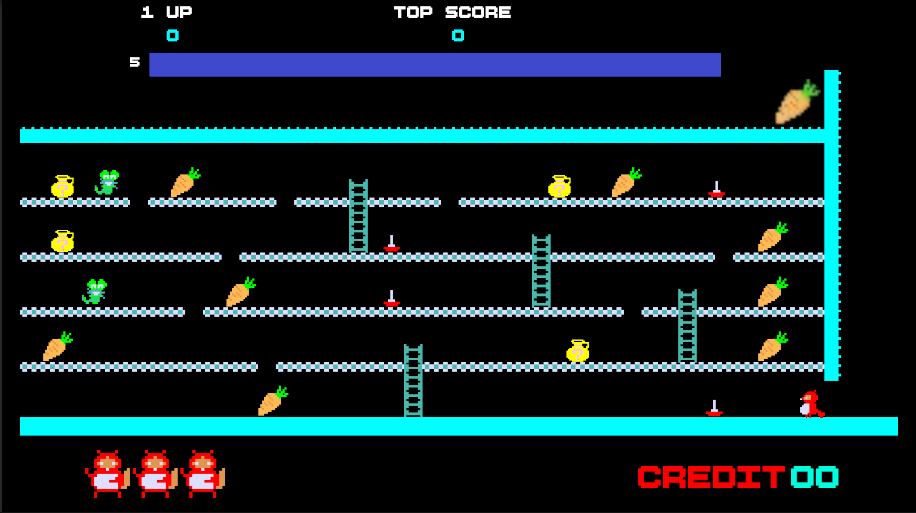

# 🦝 Ponpoko (폰포코 / ポンポコ) — Unity Remake

> 1982년 세이부 전자 개발 / 시그마 발매의 전설의 아케이드 게임 **폰포코(ポンポコ, 한국명: 너구리)** 를 Unity로 재현한 2D 레트로 플랫포머 프로젝트입니다.
> 원작의 조작감·점수 룰·사망 연출까지 코드 레벨에서 분해해 충실하게 구현하는 데 초점을 맞췄습니다.


---

## 📖 프로젝트 소개

**폰포코**는 1980년대 한국 오락실을 대표했던 고전 아케이드 게임으로, 너구리 주인공이 발판과 사다리를 오르내리며 5층 구조 맵에 놓인 과일·채소를 모두 먹으면 다음 스테이지로 넘어가는 방식입니다. 적들과 스파이크 함정을 피하고, 제한시간 안에 클리어해 높은 점수를 얻는 것이 목표입니다.

이 프로젝트는 원작의 도트 그래픽과 감성을 그대로 살리면서 현대적인 Unity 엔진으로 재구현한 **1인 개발 팬 메이크 리메이크**입니다. 기획·코드·맵 디자인 전 과정을 직접 수행했으며, 학습 목적으로 AI 코딩 도구 없이 전 로직을 설계·구현했습니다.

### ✨ 주요 특징

- 🎮 **원작 재현** — 원작의 5층 스테이지 구조, 아이템, 적 패턴, 클리어 연출을 충실히 재현
- 🎨 **레트로 도트 그래픽** — 오리지널 픽셀 아트 스프라이트 및 애니메이션
- 🎵 **원작 사운드** — 8비트 감성의 BGM 및 효과음, 층별 사망 음원 동기화
- ⌨️ **아케이드 감성 조작** — 공중 방향전환 차단 등 원작 그대로의 조작감을 물리 레벨에서 구현
- ⚙️ **견고한 구조** — 싱글톤 기반 점수 관리, 코루틴 시퀀스, 상태 머신 패턴 적용

## 📸 스크린샷

> 저장소 루트에 `docs/` 폴더를 만들고 스크린샷을 `screenshot1.png`, `screenshot2.png`로 넣어주세요.




---

## 🛠 기술 스택

| 구분 | 내용 |
|------|------|
| **엔진** | Unity 2022.3.60f1 (LTS) |
| **렌더 파이프라인** | 2D Built-in Render Pipeline |
| **주요 패키지** | Unity 2D Feature 2.0.1, TextMeshPro 3.0.7, uGUI, Timeline 1.7.6 |
| **물리** | UnityEngine 2D Physics — `Rigidbody2D`, `Raycast`/`Linecast`, `ColliderDistance2D` |
| **맵** | Tilemap (사다리·발판 격자 구성 및 좌표 계산) |
| **아키텍처** | Singleton + `DontDestroyOnLoad`, Coroutine 시퀀스, 상태 머신(플래그 조합) |
| **데이터 영속화** | PlayerPrefs (하이스코어) |
| **폰트** | NeoDunggeunmo (네오둥근모), BoldPixels |
| **언어** | C# (.NET Standard 2.1) |

---

## 📁 프로젝트 구조

```
Assets/
├── animation/          # 애니메이션 클립 및 Animator Controller
│   ├── player.controller              # 플레이어 메인 애니메이터
│   ├── character-jump-land.controller # 타이틀/인트로용 애니메이터
│   ├── run.anim / jump.anim / ladder.anim
│   ├── death.anim / dance.anim / intro_run.anim
│   └── ...
├── Audios/             # BGM 및 효과음 에셋
├── BoldPixels/         # 레트로 픽셀 폰트
├── pal/                # 팔레트 스프라이트 시트
├── prefab/             # 게임 오브젝트 프리팹 (플레이어, 적, 아이템 등)
├── Scenes/             # 게임 씬 (타이틀 basic, stage1 ~ stage10)
├── script/             # C# 게임 로직 스크립트
│   ├── gameManager.cs              # 싱글톤, 점수/라이프, 클리어 시퀀스
│   ├── playerController.cs         # 이동/점프/사다리/사망 전체 로직 (핵심)
│   ├── JarSpawnEnemyController.cs  # 적 스폰 연출 및 패트롤 AI
│   ├── scoreUI.cs / timeBar.cs     # 점수 UI / 제한시간 바
│   ├── gruopLayoutUI.cs            # 목숨(라이프) UI
│   └── ScoreEffect.cs              # 획득 점수 팝업 이펙트
├── Sprites/            # 도트 스프라이트 에셋 (캐릭터, 배경, UI)
└── UI prefab/          # UI 프리팹 (HUD, 메뉴 등)
```

### 🎭 플레이어 애니메이션 상태

`player.controller` 에서 관리되는 플레이어 상태:

| 상태 | 설명 | 전환 조건 |
|------|------|-----------|
| **Idle** | 대기 (정면/측면 스프라이트를 방향에 따라 직접 교체) | — |
| **run** | 좌우 이동 | `IsRunning = true` |
| **jump** | 점프 (프레임을 물리 높이에 동기화해 수동 스크러빙) | 점프 입력 → 코루틴에서 `Play`로 직접 제어 |
| **ladder** | 사다리 오르내리기 | `IsClimbing = true` (속도: `ClimbSpeed`) |
| **death** | 사망 (추락 시 회전 프레임을 진행률에 비례해 재생) | `Die` 호출 |

**Animator 파라미터**: `IsRunning`, `IsClimbing`, `Jump`, `IsGrounded`, `ClimbSpeed`, `Die`

---

## ✨ 핵심 구현 (기술 포인트)

### 1. 아케이드 조작감 재현 — 커스텀 점프 물리
- **공중 X속도 고정**: 점프 순간 결정된 방향으로만 날아가고 공중 방향전환을 완전 차단해, 원작 특유의 "꽉 막힌" 조작감 구현
- **숏/롱 점프 분단**: 버튼 홀드 시간이 아닌 **이동 입력 유무**로 낮은 점프(제자리)와 높은 점프(이동 중)를 나눠 원작 규칙에 충실
- **3단계 중력 제어**: 상승(약) → 정점 부근(체공) → 하강(강)으로 `gravityScale`을 매 물리틱마다 재대입해 둥근 포물선 구현
- 점프의 시작→상승→정점→하강→착지 전 과정을 **코루틴 단일 흐름**으로 관리

### 2. 물리 높이 ↔ 애니메이션 프레임 정밀 동기화
`anim.speed = 0` → `anim.Play(state, layer, normalizedTime)` → `anim.Update(0)` 3종 세트로 애니메이터 자동 재생을 끄고 **프레임을 직접 스크러빙**하는 기법을 적용했습니다.
- 점프 클립의 키프레임(5→10→15→20→25)을 상승률·낙하 높이 비율에 매핑
- 정점 자세(15~20프레임 구간 중앙 = 17.5/30)를 물리 최고점과 정확히 일치
- 하강 구간은 `sqrt` 보간으로 실제 낙하 가속도와 자연스럽게 연결

### 3. 사다리 시스템 & 타일맵 좌표 계산
- `Tilemap.WorldToCell` / `HasTile` / `GetCellCenterWorld`로 격자를 직접 순회해 **사다리 정중앙 X좌표를 계산**한 뒤 스냅 탑승
- 사다리 자리는 바닥이 뚫려 `Linecast`가 `false`를 리턴하는 문제를 "사다리 근처 시 중력 0 + Y속도 0" 예외 규칙으로 보완 → 추락 버그 해결
- 사다리 탈출 시 거리를 **0.6f로 제한한 짧은 Raycast**로 "현재 층 바닥"만 감지 → 아래층 순간이동 버그 원천 차단

### 4. 추락사 — 물리 공식 역산으로 사운드 싱크
등가속도 운동 공식 `s = ½·a·t²`을 응용해, 사망 음원 길이에서 충돌음 구간을 뺀 시간 안에 맨 아래에 도달하도록 중력 배율을 **역산**(`a = 2s/t²`)했습니다. 이를 통해 "비명이 끝나는 타이밍 = 바닥 도착 타이밍"을 정확히 일치시켰습니다.
- 5개 층별 사망 음원(Death1~5) 분리, 층이 높을수록 긴 비명 + 많은 회전 수
- 추락 중 콜라이더 비활성화로 중간 층 통과, 회전 애니메이션 프레임을 낙하 진행률에 비례해 수동 재생

### 5. 원작 룰 재현 — 위층 트랩 예외 처리
트리거 충돌은 접촉점 정보가 없다는 한계를 `Physics2D.Distance`로 우회했습니다. 두 콜라이더의 최접점을 계산해 **"머리로 위층 트랩 밑면에 부딪힌 경우"는 사망 판정을 무시**하여, 원작의 "트랩은 밟아야 죽는다"는 룰을 충실 구현했습니다.

### 6. 점수·스테이지 관리 시스템
- 과일 콤보 테이블 `{10, 20, 30, 50, 100, 200, 300, 500, 1000}` — 8개 획득 시 스테이지 클리어
- 항아리(Jar) 보너스 = **현재 과일 점수의 2배**
- 클리어 시 남은 시간 × 스테이지 배율의 시간 보너스, `BONUS` → `NEXT PATTERN` 연출을 코루틴으로 시퀀싱 (UI 미연결 시 Canvas/Text를 코드에서 자동 생성하는 폴백 포함)
- **싱글톤 + `DontDestroyOnLoad`**로 씬 전환 간 점수·라이프 유지, `PlayerPrefs`로 하이스코어 영속화
- 사망 시 해당 스테이지 점수 롤백, 목숨 소진 시 데이터 리셋 후 타이틀 씬으로 복귀

### 7. 적 AI & 스폰 연출
- 스폰 시 깜빡임 무적 시간 동안 `Physics2D.IgnoreCollision`으로 플레이어와의 충돌 자체를 차단
- 연출 종료 후 왕복 패트롤 + 벽(`wall` 태그) 감지 방향 전환

### 8. 엔지니어링 습관
- 모든 컴포넌트 참조를 `Start()`에서 **1회만 캐싱** (`GetComponent`/`FindObjectOfType` 매 프레임 호출 방지)
- `Animator.StringToHash` 정적 해시 사용으로 문자열 비교 회피
- `isJumping` / `ladderTrigger` / `isDead` / `isLadderTop` 플래그 조합의 명시적 상태 머신 + early return 가드
- `[Header]` / `[Tooltip]` / `[SerializeField]`로 인스펙터 가독성 확보, 주요 변수마다 의도를 주석으로 기록

---

## 🚀 설치 및 실행

### 요구 사항
- Unity Hub
- Unity Editor **2022.3.60f1** (LTS) — [다운로드](https://unity.com/releases/editor/archive)
- Windows / macOS / Linux

### 실행 방법
1. 저장소를 클론합니다:
   ```bash
   git clone https://github.com/<your-username>/ponpoko-unity.git
   cd ponpoko-unity
   ```
2. Unity Hub에서 **Open → Add project from disk** 로 프로젝트 폴더를 추가합니다.
3. Unity Editor로 프로젝트를 엽니다 (첫 실행 시 패키지 임포트로 시간이 소요됩니다).
4. `Assets/Scenes/` 폴더에서 **basic(타이틀) 씬**을 열고 **Play** 버튼을 누릅니다.

### 빌드 방법
1. 메뉴에서 **File → Build Settings** 를 열고 `basic`과 `stage1~10` 씬을 등록합니다.
2. 타겟 플랫폼(Windows/macOS/Linux)을 선택하고 **Switch Platform** 을 클릭합니다.
3. **Build** 를 눌러 실행 파일을 생성합니다.

---

## 🎮 조작법

| 키 | 동작 |
|----|------|
| `←` `→` / `A` `D` | 좌우 이동 |
| `↑` `↓` / `W` `S` | 사다리 오르내리기 |
| `Space` | 점프 |
| `Space` (타이틀 화면) | 게임 시작 |

---

## 🎯 게임 플레이

### 목표
- 5층 맵에 배치된 **과일·채소(사과, 딸기, 수박, 포도, 당근, 버섯 등) 8개를 모두 수집**하면 스테이지 클리어!
- **항아리** 획득 시 현재 과일 점수의 2배 보너스
- 적 캐릭터·스파이크 함정과 접촉하거나 낙사 구멍에 빠지면 생명이 차감됩니다 (총 3목숨)
- 제한 시간 내 클리어 시 남은 시간 × 스테이지 배율의 보너스 점수 획득
- 클리어 후 `BONUS 점수` → `NEXT PATTERN` 연출을 거쳐 다음 스테이지로 이동

---

## 🎨 에셋 정보

- **스프라이트**: 원작 게임 그래픽을 기반으로 한 픽셀 아트
- **폰트**: [NeoDunggeunmo](https://neodgm.dalgona.dev/) (네오둥근모) — 배포용 무료 픽셀 폰트 / BoldPixels
- **사운드**: 8비트 칩튠 스타일 BGM 및 효과음

---

## 👤 개발 정보

- **인원**: 1인 개발 (기획·코드·맵 디자인 전체)
- **기간**: 약 5주 (1개월+)
- **목적**: Unity 2D 물리·코루틴·상태 관리 학습 / 고전 게임 리버스 엔지니어링 연습
- **특이사항**: AI 코딩 도구 미사용, 전 로직 직접 설계 및 구현

## 📚 이 프로젝트에서 배운 점

- 코루틴을 "시간에 따른 흐름 제어" 도구로 활용하는 법 (점프 생명주기, 클리어 시퀀스, 사망 연출)
- 물리 공식을 게임플레이에 응용하는 사고 (중력 역산, 키프레임-물리 매핑)
- 2D 충돌 판정의 한계(트리거는 접촉점 정보 없음)를 `Distance`/`Raycast`로 우회하는 기법
- 씬 간 데이터 영속화 패턴 (싱글톤 + `DontDestroyOnLoad` + `PlayerPrefs`)
- 원작을 플레이하며 규칙을 분해 → 추출 → 코드로 구현하는 리버스 엔지니어링 경험

## 🔮 개선 예정

- [ ] 설정 메뉴 (사운드 볼륨, 조작 키 변경)
- [ ] 모바일 터치 조작 지원 (Input System 전환)
- [ ] 오브젝트 풀링으로 적·점수 이펙트 생성 최적화

---

## ⚠️ 저작권 고지

본 프로젝트는 순수 학습·연구 목적의 **팬메이드 리메이크**이며 비상업적 프로젝트입니다.
원작 게임(폰포코/ポンポコ/너구리)의 모든 저작권과 상표권은 원 저작권자에게 귀속되며, 상업적 이용은 금지됩니다.
사용된 리소스 중 원작 유사 요소가 있다면 권리자 요청 시 즉시 교체·삭제하겠습니다.

## 📄 License

코드 한정 **MIT License** — 원작 리소스는 제외됩니다.

---

<div align="center">

🎮 **1982년의 감동, 2026년의 코드로 다시 플레이하다** 🦝

</div>
